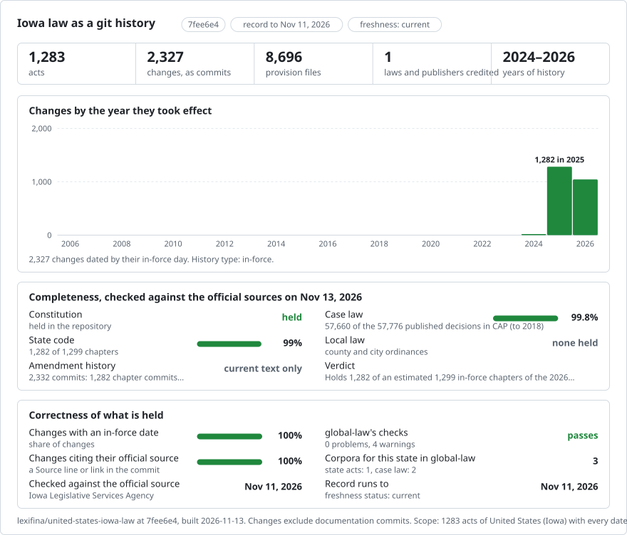

# Iowa: law history in git

<picture>
<source media="(prefers-color-scheme: dark)" srcset="data/effort-dark.svg">

</picture>

Part of [lexifina/global-law](https://github.com/lexifina/global-law).

This repository is partially rebuilt from Internet Archive captures of the official 2026 Code of Iowa, published by the Iowa Legislative Services Agency.

| Coverage | Acts | Record |
| --- | ---: | --- |
| Code chapters in official Volumes I–VII | 1044 | An archived 2026 edition version, dated 2026-01-01 |
| Other pre-existing Code chapters | 238 | Earlier corpus records retained |
| Codified Constitution | 1 | Earlier corpus record retained |

The archived edition chapters are stored as one text file per chapter, including the source chapter analysis, section histories and notes. Historical section files remain available at their existing versions.

## Sources and dates

The official cover and preface state that the 2026 Code includes enactments with January 1, 2026, or earlier effective dates through the Ninety-first General Assembly's 2025 Regular Session. January 1, 2026 is the currency date of this edition, not a claim that every provision first commenced that day. Each new version cites its exact archive URL and capture timestamp.

The archive sources are:

- https://web.archive.org/web/20260106142300id_/https://www.legis.iowa.gov/docs/publications/ICV/1594653.pdf
- https://web.archive.org/web/20260106145156id_/https://www.legis.iowa.gov/docs/publications/ICV/1594654.pdf
- https://web.archive.org/web/20260106145849id_/https://www.legis.iowa.gov/docs/publications/ICV/1594657.pdf
- https://web.archive.org/web/20260106160008id_/https://www.legis.iowa.gov/docs/publications/ICV/1594658.pdf
- https://web.archive.org/web/20260106164303id_/https://www.legis.iowa.gov/docs/publications/ICV/1594656.pdf
- https://web.archive.org/web/20260106174416id_/https://www.legis.iowa.gov/docs/publications/ICV/1594655.pdf
- https://web.archive.org/web/20260107034655id_/https://www.legis.iowa.gov/docs/publications/ICV/1594659.pdf

## Coverage gaps

Official Volume VIII is not included in this archive rebuild. Its chapters retain earlier corpus records. Session laws, regulations and reconstructed amendment histories are not included. Earlier corpus Code records use 2025-10-20 and the codified Constitution uses 2024-12-09; these historical labels are edition or production dates and do not establish commencement dates.

Statutory text is credited to the Iowa Legislative Services Agency; Internet Archive is credited for preserving the cited official publications.
